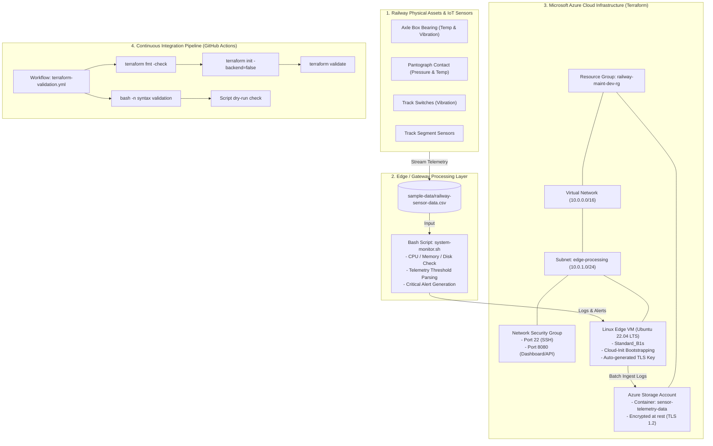

# 🚄 Railway Asset Maintenance System - System Architecture & Design

## 1. Overview

The **Railway Asset Maintenance System** is an enterprise-grade IoT telemetry monitoring and cloud infrastructure project designed to track, diagnose, and maintain high-value railway infrastructure assets in real time.

Railway networks depend on mission-critical assets such as:
- **Axle Box Bearings**: Overheating or high vibration causes catastrophic wheel derailment.
- **Pantographs**: Inconsistent contact pressure with overhead electrical catenary wires leads to power loss or wire snags.
- **Track Switches / Turnouts**: Mechanical alignment and vibration shifts indicate points machine wear.
- **Track Segments**: Vibration spikes pinpoint rail cracks or track bed degradation.

This project delivers Infrastructure as Code (Terraform on Microsoft Azure), edge diagnostic scripting (Bash on Linux), and continuous integration quality gates (GitHub Actions).

---

## 2. High-Level Architecture Diagram

---

## 3. Component Breakdown

### A. Infrastructure as Code (Terraform & Azure)
All cloud resources are provisioned declaratively using Terraform:
- **`azurerm_resource_group`**: Isolated container for lifecycle management and cost tracking.
- **`azurerm_virtual_network` & `azurerm_subnet`**: Dedicated private network space (`10.0.0.0/16`) isolating maintenance servers from direct exposure.
- **`azurerm_network_security_group`**: Stateful firewall with granular inbound rules for SSH administration (port 22) and monitoring dashboards (port 8080).
- **`azurerm_linux_virtual_machine`**: Ubuntu 22.04 LTS compute node deployed with cloud-init bootstrapping scripts.
- **`tls_private_key`**: Ephemeral 4096-bit cryptographic key pair ensuring no passwords or shared credentials exist.
- **`azurerm_storage_account` & `azurerm_storage_container`**: Scalable blob storage for raw telemetry logs with private endpoint enforcement.

### B. Linux & Bash Diagnostic Engine (`scripts/system-monitor.sh`)
The shell automation script acts as an edge daemon or maintenance diagnostic tool:
- **Strict Execution**: Uses `set -euo pipefail` to guarantee safe scripting.
- **System Metrics**: Gathers CPU load averages, memory consumption ratios, and disk usage against configurable warning thresholds (e.g., 80%).
- **Telemetry Parsing**: Ingests sensor data line-by-line, calculates health ratios (Normal, Warning, Critical), and flags anomalous units needing dispatch.
- **Persistent Logging**: Writes structured, timestamped logs with ISO 8601 formatting to `logs/`.

### C. CI/CD Quality Gate (GitHub Actions)
The workflow `.github/workflows/terraform-validation.yml` guarantees code quality before merging:
- **Zero-Cost Verification**: Runs `terraform init -backend=false` and `terraform validate` without requiring Azure subscriptions or live cloud credentials.
- **Formatting Enforcement**: Runs `terraform fmt -check -diff` to ensure all team members adhere to official HCL formatting standards.
- **Shell Validation**: Validates shell syntax with `bash -n` and verifies execution paths against sample datasets.

---

## 4. Telemetry Data Model

Sensor streams are represented in CSV format (`sample-data/railway-sensor-data.csv`) with the following schema:

| Column Name | Type | Description | Alert Condition |
| :--- | :--- | :--- | :--- |
| `timestamp` | ISO 8601 String | UTC recording timestamp | N/A |
| `asset_id` | String | Unique railway identifier (e.g., `AXL-TRAIN-12002`) | N/A |
| `asset_type` | Enum | Asset category (Bearing, Pantograph, Switch, Track) | N/A |
| `location_km` | Float | Track kilometer marker along the railway division | N/A |
| `temperature_celsius` | Float | Operational temperature in Celsius | `> 70°C` (Bearing / Pantograph) |
| `vibration_rms_mm_s` | Float | Root Mean Square vibration in mm/s | `> 4.5 mm/s` (Mechanical degradation) |
| `pressure_bar` | Float | Pneumatic/contact pressure in bar | `< 5.0 bar` (Pressure loss) |
| `status` | Enum | Health status (`Normal`, `Warning`, `Critical`) | `Warning` or `Critical` |
| `maintenance_recommended`| Boolean | Maintenance flag (`Yes` / `No`) | `Yes` |

---

## 5. Security and Governance

1. **No Hardcoded Secrets**: All access uses SSH keys generated dynamically via the Terraform `tls` provider.
2. **State File Protection**: `.gitignore` is configured to prevent committing `.tfstate` files, secrets, `.pem` files, or production variable sets.
3. **Restricted Storage**: Storage containers are set to `private` access to avoid unauthorized public reads.
4. **Transport Encryption**: Minimum TLS version is locked to `TLS 1.2` across cloud storage endpoints.
